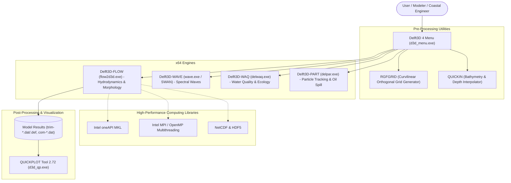

# 🌊 Delft3D 4 Suite (4.07.02) — Community Windows Installer

<p align="center">
  <b>English</b> •
  <a href="README.id.md">Bahasa Indonesia</a> •
  <a href="README.nl.md">Nederlands</a> •
  <a href="README.es.md">Español</a> •
  <a href="README.fr.md">Français</a> •
  <a href="README.zh.md">中文</a>
</p>

[](https://www.gnu.org/licenses/gpl-3.0)
[]()
[](https://github.com/Deltares/Delft3D)
[](https://drive.google.com/drive/folders/1n4nYRUO1JAszAicliTmhP5IbFDc4uOIP?usp=sharing)
[](../../releases)
[](CITATION.cff)

> **⚠️ Legal Disclaimer & Copyright Attribution:**  
> This repository is an independent community project (*Unofficial Community Packaging & Distribution*) created to assist students, researchers, coastal engineers, and oceanographers with installing the classic structured/curvilinear **Delft3D 4 Suite (Version 4.07.02)** on Windows systems instantly without complex manual compilation.  
> All source code, simulation engines (*kernels*), and graphical user interfaces (*Delft3D Menu, RGFGRID, QUICKIN*) are developed by and are the copyrighted property of **[Stichting Deltares](https://www.deltares.nl/)**, Delft, The Netherlands. This project is **not officially affiliated with or endorsed by Deltares**, and is provided strictly in adherence with Deltares' official Open Source licensing terms and integration guidelines.

---

## 🏗️ Integrated Architecture Overview

The diagram below illustrates how the classic Delft3D 4 Menu environment, pre-processors, calculation engines, and post-processing visualization utilities interact within this packaged distribution:



---

## 📚 Documentation & Technical Guides

Comprehensive setup guides and technical workflows are available in the [`docs/`](docs/) directory:

| Document | Description |
| :--- | :--- |
| 📖 [**Installation Guide**](docs/PANDUAN_INSTALASI.md) | Step-by-step walkthrough to run the standalone installer |
| 🔑 [**Official Deltares License Guide**](docs/PANDUAN_LISENSI_DELTARES.md) | How to obtain a 100% free (**€ 0.00**) official license file directly from Deltares |
| 🛠️ [**Troubleshooting & FAQ**](docs/TROUBLESHOOTING.md) | Solutions for common hurdles (Visual C++ runtime, SmartScreen, FlexNet registry) |
| ⚙️ [**Source Code Compilation Guide**](docs/PANDUAN_KOMPILASI_SOURCE.md) | Complete guide for building calculation kernels from upstream source code |
| 🛡️ [**Privacy & Security Policy**](SECURITY.md) | Guarantee regarding privacy, zero telemetry, and exclusion of private credentials |

---

## 📦 What Is Included in This All-in-One Package?

This standalone setup executable bundles the complete Delft3D 4 modeling ecosystem into a single installer:

1. **Delft3D 4 Menu & Module GUIs (4.07.02)**: The classic Deltares modeling interface for FLOW, WAVE, WAQ, PART, and TIDE.
2. **Grid & Bathymetry Pre-processors**:
   * **RGFGRID**: Advanced curvilinear orthogonal grid generator for coastal waters, rivers, and estuaries.
   * **QUICKIN**: Depth, bathymetry, and roughness interpolation tool with triangular interpolation and sample smoothing.
3. **Complete 64-bit Numerical Engines (Kernels)**:
   * **Delft3D-FLOW (`flow2d3d.exe`)**: Hydrodynamic flow and morphodynamic simulation engine.
   * **Delft3D-WAVE (`wave.exe` & SWAN)**: Short-crested wave computation on curvilinear grids.
   * **Delft3D-WAQ (`delwaq.exe`)**: 3D water quality and chemical/biological transport engine.
   * **Delft3D-PART (`delpar.exe`)**: Mid-field particle tracking for oil spills and conservative tracers.
   * Calculation utilities: `datsel.exe`, `kubint.exe`, `lint.exe`, `nesthd1.exe`, `nesthd2.exe`, `run_delwaq.bat`, `run_delpar.bat`, etc.
4. **QUICKPLOT Tool 2.72 (Windows 64-bit)**: Visual post-processor for vector fields, water levels, cross-sections, and time series animations.
5. **Automated Licensing Environment**: Automatically configures the FlexNet search directory (`C:\Program Files (x86)\DS_Flex`) and registry entries.

---

## 🔒 Privacy & User Data Protection

> [!IMPORTANT]
> To protect individual privacy, this installer package **DOES NOT bundle any personal license files**. Every user is guided to obtain their own official, 100% free (**€ 0.00**) license file directly from the Deltares portal under their own identity (takes approximately 2 minutes).

### How to Get Your Free Official Deltares License:
1. Visit the official download portal: [Deltares Delft3D 4 Open Source GUI](https://download.deltares.nl/delft3d-4-suite-graphical-user-interface-gui-open-source).
2. Click **"Order"** / **"Add to Cart"** (Cost: **€ 0.00 / Free of Charge**), then proceed to **Checkout**.
3. Fill in your name, university/organization, and email address, then click **Submit Order**.
4. Check your email inbox and download your `.lic` license file (e.g. `Delft3D4_GUI_OSS.lic`).  
*(For detailed instructions, see [docs/PANDUAN_LISENSI_DELTARES.md](docs/PANDUAN_LISENSI_DELTARES.md))*.

---

## 🚀 Download & Installation

### 1. Download the Installer Executable

You can download the ready-to-use setup executable directly from the cloud link below without any source code compilation:

| Download Source | Download Link | Description |
| :--- | :---: | :--- |
| 🚀 **Google Drive (Recommended)** | [**Download via Google Drive**](https://drive.google.com/drive/folders/1n4nYRUO1JAszAicliTmhP5IbFDc4uOIP?usp=sharing) | High-speed direct cloud mirror, precompiled and ready |
| 📦 **GitHub Releases** | [**Download via GitHub Releases**](../../releases) | Official repository binary release mirror |

> **Installer Details:**
> * **Filename**: `Delft3D_4_Suite_4.07.02_AllInOne_Setup.exe`
> * **Target Architecture**: Windows 64-bit (x64)
> * *(Note: The Google Drive folder also contains the optional `vc_redist.x64.exe` Microsoft runtime installer if needed).*

### 2. Run the Setup Wizard
1. Right-click `Delft3D_4_Suite_4.07.02_AllInOne_Setup.exe`, select **Run as administrator**.
2. Select desired components (Delft3D 4 Core GUI & Kernels, RGFGRID, QUICKIN, QUICKPLOT).
3. **License Configuration:**
   * **Option 1 (Recommended):** Choose *"Select official license file (.lic) obtained from Deltares"* -> Click **Browse** -> Select your `Delft3D4_GUI_OSS.lic` file downloaded from Deltares. The installer will automatically place and configure it.
   * **Option 2:** Choose *"Skip"* if you prefer to copy your license to `C:\Program Files (x86)\DS_Flex\` manually later.
4. Click **Install**. Launch Delft3D 4 directly from your Desktop or Start Menu!

---

## 🔗 Official Deltares Links (Upstream)

For official documentation, upstream source code, and community discussions:
* 🌐 **Official Deltares Website**: [https://www.deltares.nl/](https://www.deltares.nl/)
* 💻 **Official Source Code Repository**: [https://github.com/Deltares/Delft3D](https://github.com/Deltares/Delft3D)
* 📥 **Deltares Software Download & Licensing Portal**: [https://download.deltares.nl/](https://download.deltares.nl/)
* 📚 **Delft3D 4 Official Documentation & Manuals**: [https://oss.deltares.nl/web/delft3d](https://oss.deltares.nl/web/delft3d)
* 💬 **Deltares GitHub Community Discussions**: [Deltares GitHub Discussions](https://github.com/Deltares/Delft3D/discussions)

---

## 📖 Academic Citations

If you use this community distribution or Delft3D 4 in your academic research, thesis, dissertation, journal publication, or consulting project, **please properly cite Deltares and foundational Delft3D scientific publications**:

### APA Format:
> Deltares. (2026). *Delft3D 4 Suite: Hydrodynamics, Waves, Water Quality and Morphology Simulation System for Curvilinear Grids*. Stichting Deltares, Delft, The Netherlands. https://www.deltares.nl/en/software-and-data/products/delft3d-4-suite

### BibTeX Format:
```bibtex
@manual{DeltaresDelft3D4Suite,
  author       = {{Deltares}},
  title        = {{Delft3D 4 Suite: Integrated Hydrodynamics, Wave, Sediment Transport and Water Quality Simulation System}},
  organization = {Stichting Deltares},
  address      = {Delft, The Netherlands},
  year         = {2026},
  url          = {https://oss.deltares.nl/web/delft3d}
}
```

---

## 📄 License & Attribution

- **Deltares Calculation Kernels & Codebase**: Licensed under the GNU General Public License v3.0 (GPLv3) and LGPLv3 by Stichting Deltares.
- **Installer & Packaging Scripts**: Open source under the MIT License.
